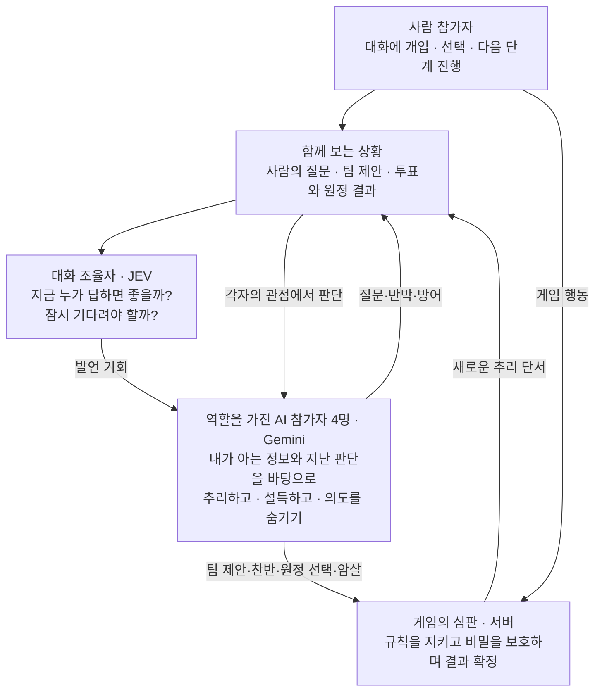
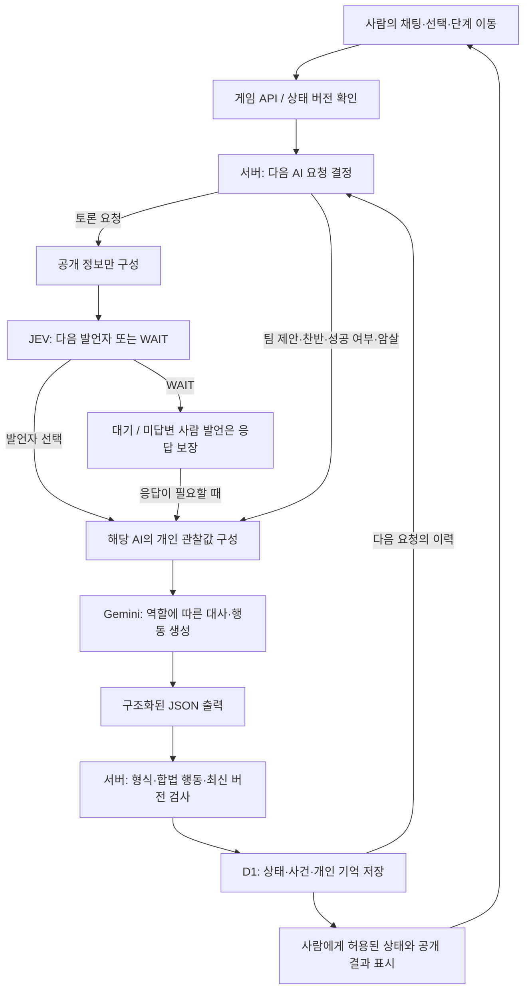
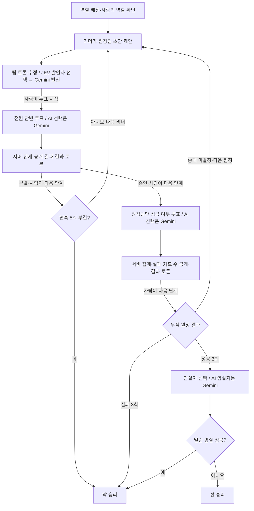

# 아발론 게임 구조와 핵심 개선

2026-10-06 로컬 코드와 작업일지 기준. 사람 1명과 AI 4명이 참여하는 5인 아발론이다. JEV는 공개 대화에서 다음 발언자를 선택하고, Gemini는 선택된 플레이어의 대사와 게임 행동을 생성한다. 서버는 규칙·차례·비밀 정보·상태 저장을 책임진다.

## 자연스러운 게임을 위한 AI 역할

설계 목표는 사람이 역할과 의도를 가진 네 명의 AI와 서로 의심하고 설득하며 플레이하는 것이다. 이를 위해 대화의 차례를 조율하는 역할과 실제 참가자로 판단하는 역할을 나눴다.

**대화의 자연스러움:** JEV가 공개 대화의 맥락을 보고 다음 발언자 또는 대기를 선택한다. 명시적으로 답장 대상을 지정한 경우에는 코드가 그 대상을 연결한다. 사람의 질문이 답 없이 묻히지 않도록 별도 보호 규칙을 둔다.

**참가자의 개성·의도·연속성:** Gemini는 각 AI의 역할·성향·허용된 정보·개인 기억을 받아 발언과 행동을 만든다. 멀린은 악을 알지만 정체를 숨겨야 하고, 충신은 공개 단서로 추리하며, 악은 선으로 보이면서 승리를 노리도록 목표를 부여한다. 같은 사건을 각자의 관점에서 해석하게 하려는 설계다.

**대화와 게임의 연결:** 팀을 정한 뒤 바로 투표하지 않고 토론과 수정 기회를 둔다. 선택 결과는 다음 토론의 근거가 된다. AI 발언 묶음을 제한하고 사람이 단계 이동을 결정해 읽고 개입할 여지를 남긴다.

발표 설명: “JEV는 누가 말할지 조율하고, Gemini는 각 인물의 입장에서 무엇을 말하고 선택할지 판단합니다. 그 선택이 게임 결과로 돌아오고, 결과가 다시 추리와 설득의 재료가 되도록 구성했습니다.”

이 도식의 추리·설득·정체 은폐는 역할에 부여한 목표다. 실제 자연스러움과 전략 품질의 향상은 별도 평가가 필요한 상태다. 첫 고정 안내, 코드 계산기의 일부 팀 제안, 장애 대체 경로는 아래 상세 설명에 구분한다.

## 기술 참고용 모델 입출력

위 도식은 JEV 모드의 대표 경로다. 화면이 `ADVANCE`를 요청하면 서버가 다음 AI 작업을 정한다. 모델이 독립적으로 계속 실행되는 구조는 아니다.

| 구분 | 입력 | 출력과 반영 |
| --- | --- | --- |
| JEV `jev-1.13.0` | 현재 단계·리더·원정팀, 최근 공개 발언 8개와 필요한 답장 연결, 최근 제안·공개 투표·원정 결과, 응답할 발언 ID | `responder`에 AI ID 또는 `WAIT`, 해당 기존 발언의 `speechAct`, 신뢰도·선택 확률. 서버가 발언자를 선택하는 데 사용 |
| Gemini `gemini-3.5-flash-lite` | 요청 행동, V3 역할·성향 프롬프트, 최근 공개 채팅 20개와 일부 이전 답장, 공개 사건·제안·원정 기록, 본인 역할·허용된 정체 정보·본인 카드·직전 채택된 생각, 역할 후보·악 확률 보조정보 | `CHAT`/`SILENCE`, `PROPOSE`, `VOTE`, `CARD`, `ASSASSINATE` 중 요청에 맞는 JSON. 근거 `evidence`와 자기보고 `thinking`을 별도로 처리 |
| 서버 규칙 엔진 | 현재 게임 상태와 사람/AI 행동 | 차례·팀 인원·선택 권한·중복 여부 검증, 표와 카드 집계, 승패 및 단계 변경 |

**정보 경계:** 멀린은 악의 정체, 악은 악 동료, 충신은 자신의 역할과 공개 정보만 받는다. JEV에는 개인 역할·개별 비밀 카드·개인 생각을 보내지 않는다. 같은 Gemini 모델을 쓰더라도 각 AI의 입력은 분리된다.

**기억:** `thinking`은 모델이 JSON으로 작성한 자기보고다. 모델 내부 추론 전체의 기록이 아니다. 각 AI의 가장 최근 채택 내용을 다음 입력에 전달하고, 과거 내용은 로그에 남긴다. 검증 실패·폐기 응답은 개인 기억을 갱신하지 않는다.

**예외:** 첫 안내는 고정 문구다. 사람의 명시적 답장 대상은 JEV 호출을 생략할 수 있다. B 정책에서 충신 AI 리더의 초기 팀은 코드 계산기가 선택하며, 재검토에는 Gemini를 사용한다. 모델 연결이 없는 연습 모드와 장애 대체 행동은 규칙 기반이다.

근거: [AI 요청 구성](../site/lib/ai.mjs), [JEV 요청과 검증](../site/lib/discussion-routing.mjs), [개인 기억](../site/lib/thinking-memory.mjs), [게임 API](../site/app/api/game/route.ts), [규칙과 관찰값](../site/lib/game.mjs).

## 한 판의 진행

원정 인원은 2→3→2→3→3명이다. 팀 승인은 5명 중 과반 찬성으로 결정하고, 원정에 실패 카드가 하나라도 있으면 실패한다. 선 역할은 성공 카드만 낼 수 있다.

현재는 **사람이 단계 이동 버튼을 누르는 정책**이다. JEV가 투표 개시나 결과 이후 단계 이동을 결정하던 과거 자동 정책은 비교·회귀 검사 코드에 남아 있지만 운영 기본 경로가 아니다. AI 대화는 최대 3개 발언 묶음으로 제한하고, 새 사람 발언으로 재개한다. 미답변 질문·AI 준비·미완료 선택 등 이동을 막는 조건은 서버와 UI에서 검사한다.

예를 들어 사람이 “서아, 그 팀을 고른 이유가 뭐야?”라고 말하면 공개 채팅이 먼저 저장된다. 토론 요청에서 발언자를 정한 뒤, 서아의 역할·공개 이력·자기 기억만 담은 입력으로 Gemini가 답변을 만든다. 생성 중 사람이 새 말을 보내 상태가 바뀌면 낡은 응답은 게시하지 않는다. 이후 실제 찬반은 서버가 각 플레이어에게 별도 행동으로 요청하며 JEV에 표를 결정시키지 않는다.

근거: [상태 전이](../site/lib/game.mjs), [대화 제어](../site/lib/conversation.mjs), [수동 진행 명세](specs/019-manual-stage-progression.md).

## 발표에서 강조할 핵심 개선

아래 검증은 해당 작업 당시 일지에 기록된 결과이며 이번 문서 작성에서 재실행한 결과가 아니다.

| 우선순위와 개선 | 문제와 선택 | 확인된 결과와 한계 | 근거 |
| --- | --- | --- | --- |
| 1. 사람 입력과 느린 AI 요청의 분리 | AI 생성 중 채팅·투표까지 막혔다. 사람 입력을 먼저 저장하고 AI 저장 직전에 상태 버전을 다시 확인하도록 변경 | 모의 API 검사에서 AI 대기 중 사람 채팅·찬성 저장과 오래된 버전 거부 확인. 이후 DB 임대로 동일 판의 중복 AI 생성을 제한 | 일지 10/01 「AI 처리 중 사람 투표·채팅 접수」, `site/tests/api-interrupt.mjs`, `site/lib/usage.mjs` |
| 2. 모델 오류를 게임 중단과 분리 | 잘못된 팀 인원·출력 오류·WAIT로 진행이 막혔다. 형식/규칙 검증, 제한된 재시도, 필수 행동의 규칙 기반 대체, 실패 기록 추가 | 모의 API에서 인원 오류 재요청과 HTTP 503 이후 유효 팀 대체 확인. 미답변 사람 발언의 WAIT 우회도 구현. 최근 로그에는 생성 실패 시 대체 화자가 달라지는 미해결 사례가 있음 | 일지 10/01 「AI 팀 인원 오류 복구」, 10/06 「JEV WAIT 멈춤 원인 수정」 및 「두 번째 대국…분석」 |
| 3. 팀 초안과 토론을 실제 선택 앞에 배치 | 팀 제안 직후 투표로 넘어갔다. 초안→토론·수정→사람의 투표 시작으로 분리하고 결과 토론 추가 | API에서 조기 투표·투표 중 수정 거부와 공개 결과 확인. 이후 자동 대기를 수동 단계 이동으로 변경. 최신 합성 API에서 동시 이동 1건 성공/1건 409 확인 | `docs/specs/010-roundtable-flow.md`, `docs/specs/019-manual-stage-progression.md` |
| 4. 발언자 선택과 역할 플레이 분리 | 이름·직전 발언 등에 의존하던 발언자 선택에 JEV의 공개 문맥 판단을 도입. Gemini는 해당 인물의 대사·행동에 집중 | 실제 합성 연결 smoke 기록 있음. JEV 우위·대화 자연스러움의 정량 개선은 미확인. 사람의 명시 답장과 미답변 보호는 코드 규칙으로 유지 | `docs/specs/016-jev-discussion-routing.md`, `site/lib/discussion-routing.mjs` |
| 5. V3와 개인 기억 연결 | 최근 채팅 8개, 이전 생각 미보존에서 최근 20개와 본인 직전 채택 생각을 전달하도록 변경. 사용자 V3 원문을 빌드에 연결 | 모의 공급자/API에서 두 번째 요청의 자기 기억 재입력, 공개 API 비노출, 종료 로그 보존 확인. 전략·일관성 향상은 미확인 | `docs/specs/018-user-v3-thinking-memory.md`, `docs/review-assets/v3-memory-integration-2026-10-06.json` |
| 6. 호출 비용과 채택 결과를 구분해 기록 | 성공·게시 응답 중심 기록만으로 실패·재시도 비용을 설명하기 어려웠다. 호출별 사용량 원장, 오류 기록, 채택 사건을 분리 | Gemini/JEV별 토큰·추론·재시도·폐기 및 사용량 미확인을 구분. 실제 소규모 호출 smoke 있음. 표시 비용은 저장된 단가에 따른 추정이며 전체 판 비용 절감 성과는 미측정 | `docs/specs/017-conversation-progress-and-cost.md`, `docs/observability.md`, `site/lib/usage.mjs` |

화면 시연에서는 결과 팝업도 보여주기 좋다. 원정팀, 공개 찬반, 원정 결과를 구분하고 개인 카드·비밀 역할은 제외한다. 390×668 화면까지 합성 판으로 확인한 기록이 있지만, 사용자 인지 개선을 수치로 측정한 것은 아니다. 근거: [결과 팝업 명세](specs/020-public-result-popup.md), [검증 기록](review-assets/result-popup-validation-2026-10-06.json).

## 발표 문장과 남은 과제

“이 프로젝트에서는 LLM이 플레이어의 발언과 선택을 생성하고, 서버가 규칙과 정보 경계를 보장하도록 역할을 분리했습니다. 느린 응답 중에도 사람이 개입할 수 있게 상태 버전 검사를 넣었고, 잘못된 모델 출력은 재시도와 대체 행동으로 처리했습니다. 이후 토론 단계, JEV 발언자 선택, 개인 기억과 호출별 기록을 추가해 플레이와 오류 원인을 확인할 기반을 만들었습니다.”

승률 향상·기만 능력·자연스러운 토론은 아직 입증된 성과로 발표하지 않는다. 악의 승패 목표와 위장 행동의 연결, 구체적인 선택 설명, 생성 실패 시 화자 보존이 후속 과제다. 악 확률 모형과 팀 선택 A/B도 구현·실험 기반이며 실측 계수 학습이나 승률 향상이 검증된 결과는 아니다.

발표에서는 구조→실제 실패와 수정→검증 근거→남은 모델 품질 문제 순으로 설명하면 설계 의도가 드러난다. README와 기존 현재 상태 문서의 V2·thinking 폐기 설명은 최신 코드와 다르므로 위 구조 설명의 기준으로 사용하지 않는다.
